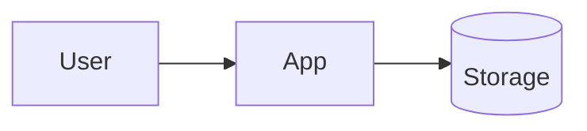
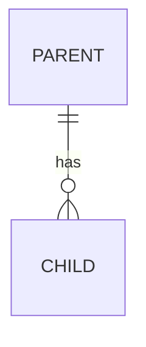

# Architecture

## Parts

<One line per part: what it does and where its code is.>

## Data flow

<Where data comes in, where it is stored, where it goes out.>

## Data model

<Rules the diagram can't show, such as who may read what.>
