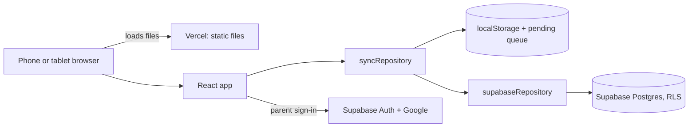
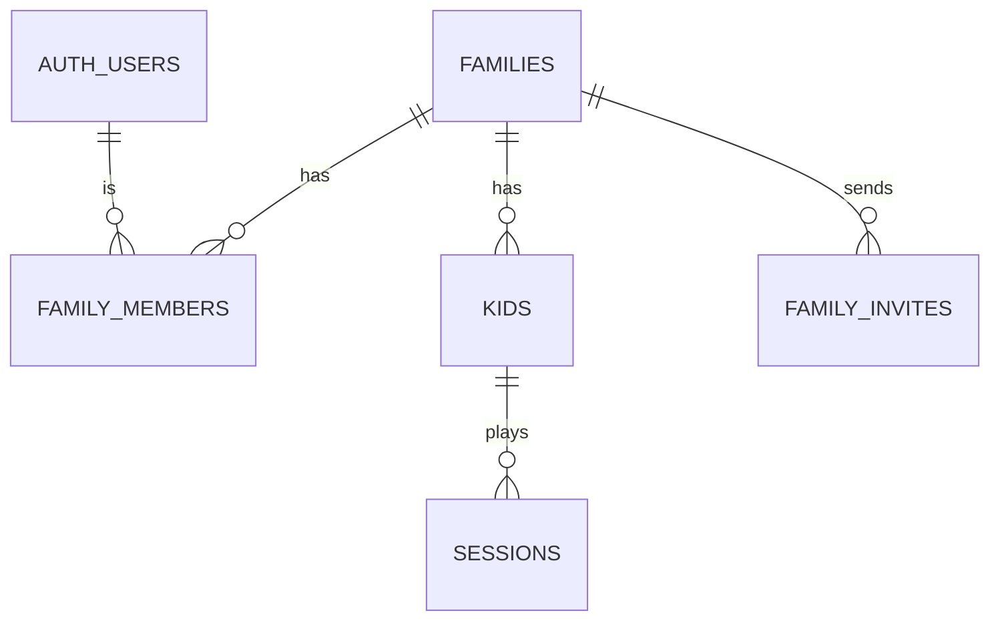

# Architecture

## Parts

| Part          | Code                   | What it does                                                 |
| ------------- | ---------------------- | ------------------------------------------------------------ |
| Game contract | `src/core/`            | `GameModule`, levels, random numbers, ids                    |
| Games         | `src/games/<id>/`      | One folder per game: pure `logic.ts` + tests, and `view.tsx` |
| Play screen   | `src/play/`            | Countdown, timer, result, shared by every game               |
| Screens       | `src/screens/`         | Picker, home, parent area, settings, family                  |
| Data          | `src/data/`            | Repositories, sync, progress maths, streaks, time limit      |
| Database      | `supabase/migrations/` | Schema and security rules, run by hand                       |

Vercel only serves files. All logic runs in the browser; all security is in
Postgres Row Level Security.

## Three ideas that hold it together

1. **Game rules are plain TypeScript.** Each game is a pure state machine:
   `create`, `reduce(state, event)`, `isOver`, `progress`. Time and random
   numbers come in as arguments, so tests need no browser.
2. **One repository interface, three implementations.** Screens only see
   `GymRepository`: `deviceRepository` (localStorage), `supabaseRepository`
   (Postgres) and `syncRepository` (both).
3. **Local first.** A finished game is saved on the device at once. If the
   server can't be reached, the write waits in a queue and goes up when the
   connection returns. Reads fall back to the device copy.

## Data flow

- **A game ends:** the browser stamps it with the device's time, saves it on
  the device, then sends it to Supabase (or queues it).
- **The app loads:** reads from Supabase, keeps a copy on the device.
- **A parent signs in:** Google → Supabase Auth. A new parent is asked to
  start a family or join one with an invite code. Invite links carry the code
  through the sign-in (`?join=CODE`). Details: [decisions/0003](decisions/0003-two-parents.md).
- **The daily limit:** worked out in the browser from the sessions it has.
  The database does not enforce it. See [known-issues.md](known-issues.md).

## Data model

| Table            | Holds                                                                      |
| ---------------- | -------------------------------------------------------------------------- |
| `families`       | One row per family (the tenant)                                            |
| `family_members` | Which signed-in parent belongs to which family. All parents are equal      |
| `kids`           | Nickname, level, avatar, colour, daily limit. Nothing else                 |
| `sessions`       | One row per finished game: kid, game, level, score, detail, time, duration |
| `family_invites` | Invite codes: who invited, expiry, used or revoked                         |

Rules the diagram can't show:

- Every table has Row Level Security. A request only sees rows whose
  `family_id` belongs to the signed-in parent (`is_family_member()`).
- Nobody can write `family_members` or `family_invites` directly. Only the
  `create_family`, `create_invite`, `accept_invite` and `revoke_invite`
  functions can.
- A trigger refuses to remove the last parent of a family.
- `sessions.id` is made by the app, so sending the same game twice updates one
  row instead of adding two.
